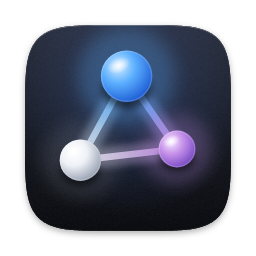
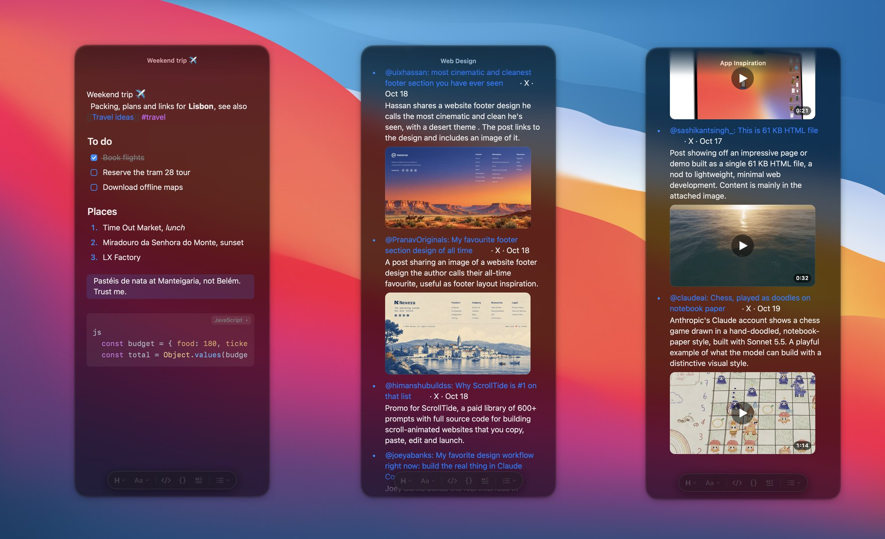

<div align="center">



# Jot

**Your notes, one keystroke away. Private by design.**

A floating notes panel for the Mac and a native Android app, synced through a server *you* own,
end-to-end encrypted.




</div>

## Why Jot

**⌨️ Always one keystroke away.** Press <kbd>⌥</kbd> <kbd>N</kbd> anywhere and Jot floats over whatever you're
doing. Write the thought down, press <kbd>Esc</kbd>, and you're back. No app to switch to and no window to find.

**🔒 Private for real.** Your notes are encrypted on your devices before they leave them. The server, which you
run yourself, only ever stores scrambled bytes. There are no accounts with anyone, no analytics and no third-party
services.

**🕸️ Notes that connect.** Link notes with `[[double brackets]]`, tag them with `#tags`, and Jot shows backlinks,
related notes and a graph of how everything fits together.

## Features

| | |
|---|---|
| ✍️ **Writing** | Markdown with live preview: the symbols disappear as you type. Headings, **bold**, *italic*, ~~strike~~, underline, checklists, numbered and bulleted lists, quotes, links |
| 🧑‍💻 **Code** | Code blocks with automatic language detection and syntax colours, scrolling sideways instead of wrapping |
| 🖼️ **Media** | Paste or drop images; videos play right inside the note |
| 🔗 **Connections** | `[[links]]` with autocomplete, backlinks (<kbd>⌘</kbd> <kbd>J</kbd>), `#tags`, related notes, and an interactive graph (<kbd>⌘</kbd> <kbd>G</kbd>) |
| 🔍 **Search** | <kbd>⌘</kbd> <kbd>K</kbd> full-text search across every note, with pinned notes on top |
| 🪟 **Mac** | Floating glass panel, several windows side by side (<kbd>⌘</kbd> <kbd>⇧</kbd> <kbd>N</kbd>), reopens exactly where you left off, updates itself |
| 📱 **Android** | Native app with the same editor, *Share → Jot* from any app, a quick-settings tile, one-tap updates |
| ☁️ **Sync** | Edits appear on your other devices within a second; works offline and catches up later; conflicts never lose text |

## How private is it?

> **The server can see:** that encrypted notes exist, how big they are, and when they change.
>
> **The server can't see:** titles, text, links, tags, images or anything else you write. Everything is sealed
> with AES-256-GCM on your device, using a key that only your passphrase can unlock.
>
> ⚠️ That also means **nobody can recover your notes if you forget your passphrase**, not even you with full access
> to the server.

## Get started

Jot is self-hosted: you run a tiny server (one file, no dependencies) and the apps sync through it. One server is
for one person. The first device that connects sets the passphrase.

**1. Run the server** on any machine with Docker, behind HTTPS, ideally reachable only by you (e.g. over
[Tailscale](https://tailscale.com) or WireGuard):

```sh
git clone https://github.com/craftwithdave/jot && cd jot/server
mkdir -p data public && sudo chown 1000:1000 data
docker compose up -d                                # listens on 127.0.0.1:8080
```

**2. Install the Mac app.** First publish it to your server, on the server machine:

```sh
cd ../mac && echo https://notes.example.com > origin.txt && ./publish.sh
```

Then on your Mac:

```sh
curl -fsSL https://notes.example.com/mac/install.sh | bash
```

Jot builds itself from source (about a minute), starts at login and lives in the menu bar. Press
<kbd>⌥</kbd> <kbd>N</kbd> and choose your passphrase.

**3. Install the Android app** (needs Docker on the server machine):

```sh
cd ../android && echo https://notes.example.com > origin.txt && ./build.sh "first version"
```

Open `https://notes.example.com/android/jot.apk` on your phone. Later versions install with one tap from inside
the app.

<details>
<summary><b>For developers</b></summary>

### Layout

| Folder | What |
|---|---|
| `server/` | Sync server: `server.js` (plain Node, no dependencies) + Docker Compose file |
| `spec/` | Reference implementation of the crypto, note logic and sync rules (JS); both apps are tested against its fixtures |
| `mac/` | Mac app (Swift, AppKit + SwiftUI), built on the Mac by `install.sh` |
| `android/` | Android app (Kotlin, Jetpack Compose), built in Docker by `build.sh` |

### HTTPS in front of the server

For example with Caddy:

```
notes.example.com {
    reverse_proxy 127.0.0.1:8080
}
```

Back up `server/data/`. It's encrypted, but it's all your notes.

### Encryption

A random 256-bit data key encrypts every note and file on the device (AES-256-GCM). The server stores that key only
wrapped with a key derived from your passphrase (PBKDF2-SHA256), plus a hash to check the passphrase.

### Android signing key

The first `build.sh` run creates your signing key in `android/keys/`. **Back it up and never publish it.**
Without it, phones can't update the app in place.

### Forking

Change the app IDs `app.jot` (`android/app/build.gradle.kts`) and `app.jot.mac` (`mac/install.sh`).

### Tests

```sh
node server/test/server.test.mjs   # server + two reference clients
mac/test/run.sh                    # Swift core vs. spec fixtures + live sync against the Node server (Docker)
android/build.sh test              # Kotlin vs. spec fixtures + fake-server sync (Docker)
```

To change a crypto, logic or sync rule: change `spec/*.mjs` first, run `node spec/fixtures.mjs`, then mirror it in
`mac/Sources/JotCore.swift` and `android/app/src/main/kotlin/app/jot/` (Logic.kt / Repo.kt / Crypto.kt).

</details>

## Credits

Code colouring by [highlight.js](https://highlightjs.org) (BSD-3, `mac/Resources/highlight.LICENSE`).
Android font: [Inter](https://rsms.me/inter/) (SIL OFL 1.1, `android/INTER-LICENSE.txt`).

## License

[MIT](LICENSE) © craftwithdave
